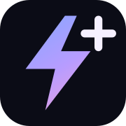

<p align="center"></p>
<h1 align="center">FlashVSR Desktop</h1>

Windows video upscaling with FlashVSR+ Turbo. Drag in a video, choose Standard or High, and save the result. The original aspect ratio and full frame are preserved automatically.

Compare the original and result in the built-in player: Before, After or a draggable slide. Playback, seeking and pause share one timeline. Full screen: **F11**; play/pause: **Space**.

## Install

Choose **one** of these two installation methods:

**EXE:** download the Windows Installer from **[Releases → Assets](https://github.com/raffaele-pet/FlashVSR-Desktop/releases/latest)** and open it.

**Repository:** clone it, or download it from **Code → Download** and extract the downloaded folder:

```sh
git clone https://github.com/raffaele-pet/FlashVSR-Desktop.git
```

Open **`Install.bat`** to download and run the latest verified installer. Then use **`Launch.bat`** or the desktop shortcut. No compilation is required. Both methods install the same application.

The guided installer prepares Python, PyTorch/CUDA, Triton, FFmpeg and the model. It shows progress, supports resumable dependency/model downloads and creates a desktop shortcut. An existing model folder can be reused. Internet is needed for installation; processing stays on your PC.

## Requirements

- Windows 10/11 x64; NVIDIA Ampere / RTX 30 series or newer. CPU, AMD and Intel are unsupported.
- Recommended: 12 GB VRAM and 32 GB RAM. At least 22 GB free for installation.
- High uses more memory and time. Maximum video size depends on available GPU memory.

Output: MP4, H.264, SDR 8-bit, nominal source frame rate, with compatible audio retained. Local playback copies support preview and comparison; upscaling always reads the original. Before/after share one decoded frame, so they cannot drift. Comparison previews are limited to 1920 pixels on the long edge; the saved result keeps its full resolution.

## Development

Build on Windows with .NET SDK 8: `powershell -ExecutionPolicy Bypass -File scripts/Build.ps1`.

Independent interface based on [OpenImagingLab/FlashVSR_Plus](https://github.com/OpenImagingLab/FlashVSR_Plus), not an official OpenImagingLab app. See [LICENSE](LICENSE) and [third-party notices](THIRD_PARTY_NOTICES.md).
