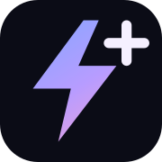

<p align="center"></p>
<h1 align="center">FlashVSR Desktop</h1>
<p align="center">Video super-resolution, without the terminal. Complete frames. Exact aspect ratios.</p>

A native Windows application and guided installer for the released **FlashVSR+ Turbo** model. Independent desktop interface; not an official OpenImagingLab application. Based on the [original FlashVSR+ engine](https://github.com/OpenImagingLab/FlashVSR_Plus), whose license, authors and documentation are preserved.

## Installazione

1. Scarica **FlashVSR-Desktop-Setup-1.0.0.exe** dalla [pagina Releases](https://github.com/raffaele-pet/FlashVSR-Desktop/releases).
2. Apri il file e scegli la cartella di installazione. Se hai già i checkpoint, puoi selezionare una cartella FlashVSR con `ckpts` per riutilizzarli dopo verifica SHA-256.
3. Premi **Installa FlashVSR**. La procedura mostra ogni passaggio, i download, le dipendenze e il registro completo. Crea automaticamente i collegamenti sul desktop e nel menu Start.
4. Apri **FlashVSR Desktop**, scegli o trascina il video, seleziona formato e qualità, scegli il file di uscita e premi **Avvia upscale**.

Non servono Python, Git, .NET o CUDA Toolkit preinstallati. Il file Setup include il runtime .NET e il codice del motore. L’installazione prepara Python 3.10 isolato, PyTorch 2.7.1/CUDA 12.8, triton-windows 3.3.1.post21, l’operatore FlashVSR Triton, FFmpeg e gli altri pacchetti. Scarica Turbo/TCDecoder da Hugging Face e verifica i checksum. Il Python di sistema e il PATH non vengono modificati.

**Requisiti hardware:** Windows 10/11 x64, GPU NVIDIA con BF16 (Ampere/RTX 30 o successiva), 12 GB VRAM consigliati, 32 GB RAM consigliati e almeno 22 GB liberi per l’installazione. Il motore originale è CUDA-only: CPU, AMD e Intel non sono supportati. La capacità massima dipende dalla GPU e dagli altri processi; un errore di memoria invita a scegliere Standard.

L’installer verifica anche i componenti Microsoft Visual C++. Se manca il driver su un PC con GPU NVIDIA, scarica e avvia la procedura NVIDIA ufficiale, verificandone la firma. Gli eventuali consensi amministratore, la scelta del driver e il riavvio restano gestiti dalla procedura NVIDIA. Il Setup dell’applicazione non è firmato digitalmente: Windows può mostrare il normale avviso per un eseguibile non firmato.

## Tutta l’inquadratura, senza crop

Il modello richiede dimensioni multiple di 128. Il worker adatta **l’intero fotogramma** alla tela del modello tramite stretch, senza ritagli. Dopo la ricostruzione ridimensiona **l’intero risultato** al rapporto esatto selezionato, prima della codifica. Non vengono modificati modello, RoPE o operatori di attenzione.

Esempio 16:9 Alta: video completo → tela **2560×1408** → uscita **2560×1440**. Standard usa **2048×1152** sia per elaborazione sia per uscita. Se l’originale ha un rapporto diverso da quello scelto, verrà stirato fino al rapporto scelto; non verrà tagliato né verranno aggiunte bande.

Le dimensioni qui sotto sono **larghezza × altezza**. I livelli mantengono un budget di pixel simile anche nei formati verticali e quadrati.

| Formato | Standard: tela → uscita | Alta: tela → uscita |
|---|---|---|
| 1:1 Square | 1536×1536 → 1536×1536 | 1920×1920 → 1920×1920 |
| 2:3 Portrait Photo | 1280×1920 → 1280×1920 | 1536×2304 → 1536×2304 |
| 3:2 Photo | 1920×1280 → 1920×1280 | 2304×1536 → 2304×1536 |
| 3:4 Portrait Standard | 1280×1792 → 1344×1792 | 1664×2176 → 1632×2176 |
| 4:3 Standard | 1792×1280 → 1792×1344 | 2176×1664 → 2176×1632 |
| 9:16 Portrait Widescreen | 1152×2048 → 1152×2048 | 1408×2560 → 1440×2560 |
| 16:9 Widescreen | 2048×1152 → 2048×1152 | 2560×1408 → 2560×1440 |
| 21:9 Ultrawide | 2304×1024 → 2352×1008 | 2944×1280 → 2912×1248 |

Il livello **Alta** mostra un avviso: richiede più memoria e può impiegare più tempo. L’app elabora tutto il video; nessun limite ai primi fotogrammi è attivo nell’interfaccia.

L’output è MP4/H.264 SDR a 8 bit, con il frame rate nominale dell’ingresso. L’audio viene copiato quando compatibile con MP4. Non è una pipeline HDR o per la conservazione di frame rate variabile/metadati avanzati.

## Installazione portabile e riparazione

La cartella predefinita è `%LOCALAPPDATA%/Programs/FlashVSR Desktop`, modificabile. Video e log utente sono separati: i video proposti in uscita vanno nella cartella Video dell’utente, sottocartella `FlashVSR`. Non esistono percorsi personali hardcoded.

**Installazione e verifica** nell’app, oppure **Ripara installazione.lnk** nella cartella del programma, riapre la procedura. I download interrotti mantengono i file `.part` e riprendono con HTTP Range; file già validi vengono riutilizzati. Un’installazione viene marcata pronta solo dopo la prova CUDA/Triton.

L’annullamento termina il processo worker e i suoi encoder figli. L’originale non viene mai modificato; il file finale viene sostituito solo dopo il completamento e la verifica. I log sono in `%LOCALAPPDATA%/FlashVSR Desktop/logs` e `installation.log` nella cartella di installazione.

## Sviluppo e build

Su Windows con .NET SDK 8:

```powershell
dotnet run --project tests/FlashVsr.Tests -c Release
python -m unittest discover -s tests -v
powershell -ExecutionPolicy Bypass -File scripts/Build.ps1
```

I test Python richiedono le dipendenze di `requirements.txt`; i test di geometria possono usare PyTorch CPU. La build genera un Setup autonomo in `artifacts/` e il suo SHA-256. L’installer contiene solo applicazione/codice; i circa 7 GB dei pesi vengono scaricati durante l’installazione. La workflow GitHub Actions verifica i servizi C#, le geometrie e la build; un tag `v*` produce una release.

Per automatizzare il deployment è disponibile anche la modalità `--install-headless --target <cartella> [--reuse-models <cartella-FlashVSR>]`; usa lo stesso servizio dell’interfaccia grafica. L’app ha inoltre `--app-root <cartella>` per i test di installazioni alternative.

## Crediti e licenze

Vedi [THIRD_PARTY_NOTICES.md](THIRD_PARTY_NOTICES.md), [LICENSE](LICENSE) e la [documentazione originale del motore](README_ENGINE.md). Logo e palette provengono dal sito ufficiale FlashVSR+. I modelli e le dipendenze restano soggetti ai termini dei rispettivi autori.
